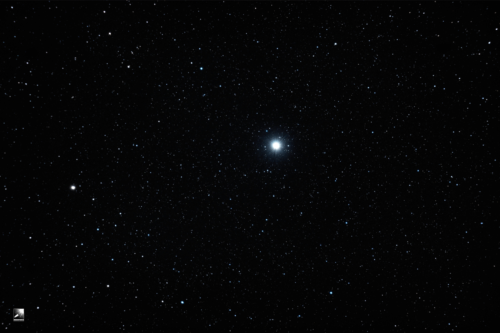
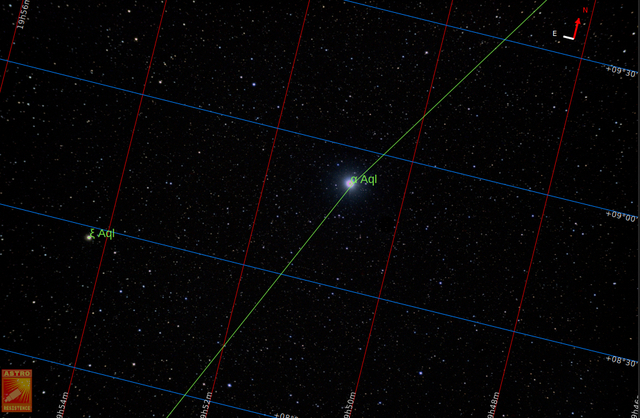
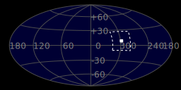
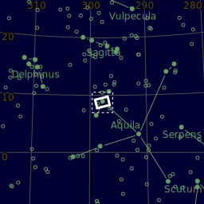
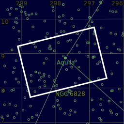

#  Altair Star

-  MAIN CAMERA: Canon EOS 2000D, uncooled, ISO=800, Exposición=29.0 s, 4 subs
-  Mount/Tracker: EQ3+Onstep
-   Main tube: SVBony SV503 80mm F7 (no field flattener)
-   AUTOGUIDING: NONE

Altair is the brightest star in the constellation of Aquila and the twelfth-brightest star in the night sky. It has the Bayer designation Alpha Aquilae, which is Latinised from α Aquilae and abbreviated Alpha Aql or α Aql. Altair is an A-type main-sequence star with an apparent visual magnitude of 0.77 and is one of the vertices of the Summer Triangle asterism with Vega; the other two vertices are marked by Deneb \\esec{sec:DenebStar} and Vega \\esec{sec:VegaStar}. It is located at a distance of 16.7 light-years (5.1 parsecs) from the Sun. Altair is currently in the G-cloud—a nearby interstellar cloud formed from an accumulation of gas and dust.Altair rotates rapidly, with a velocity at the equator of approximately 286 km/s This is a significant fraction of the star's estimated breakup speed of 400 km/s. A study with the Palomar Testbed Interferometer revealed that Altair is not spherical, but is flattened at the poles due to its high rate of rotation. Other interferometric studies with multiple telescopes, operating in the infrared, have imaged and confirmed this phenomenon.

[ Read more](https://en.wikipedia.org/wiki/Altair)
## Plate solving 

| Globe | Close | Very close |
| ----- | ----- | ----- |
| | | |

## Details

## Gallery
 

