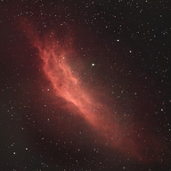
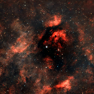
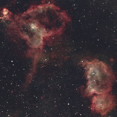
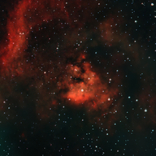

|Targets|
| :----: |
|| 

| Target | Briefing |
| -----: | :----- |
| [Full California Nebula](..//Stories//Full_California_Nebula.md)  |	|
|  |See [California Nebula](./California_Nebula.md) |
| [Gamma Cygni Nebula](..//Stories//Gamma_Cygni_Nebula.md)  |	|
|  |IC 1318 (also known as Gamma Cygni Nebula) is the diffuse emission nebula and a H II region surrounding the star Sadr (γ Cygni) at the center of Cygnus's cross thus getting a nickname Sadr Region. The Sadr Region is one of the surrounding nebulous regions; others include the Butterfly Nebula and the Crescent Nebula. It contains many dark nebulae in addition to the emission diffuse nebulae. |
| [Heart Soul Nebula](..//Stories//Heart_Soul_Nebula.md)  |	|
|  |This is a composition of three other nebulae [Fish Head Nebula](./Fish_Head_Nebula.md) (thank you LOVE) [Heart Nebula](./Heart_Nebula.md) and [Soul Nebula](./Soul_Nebula.md)  |
| [Question Mark Nebula](..//Stories//Question_Mark_Nebula.md)  |	|
|  |NGC 7822, also known as the Question Mark Nebula, is a young star forming complex in the constellation of Cepheus. The complex encompasses the emission region designated Sharpless 171, and the young cluster of stars named Berkeley 59. The complex is believed to be some 800–1000 pc distant,[5][6] with the younger components aged no more than a few million years.[5][6] The complex also includes one of the hottest stars discovered within 1 kpc of the Sun, namely BD+66 1673, which is an eclipsing binary system consisting of an O5V that exhibits a surface temperature of nearly 45,000 K and a luminosity about 100,000 times that of the Sun.[5] The star is one of the primary sources illuminating the nebula and shaping the complex's famed pillars of creation-type formations, the elephant trunks.[5][7][8] |
