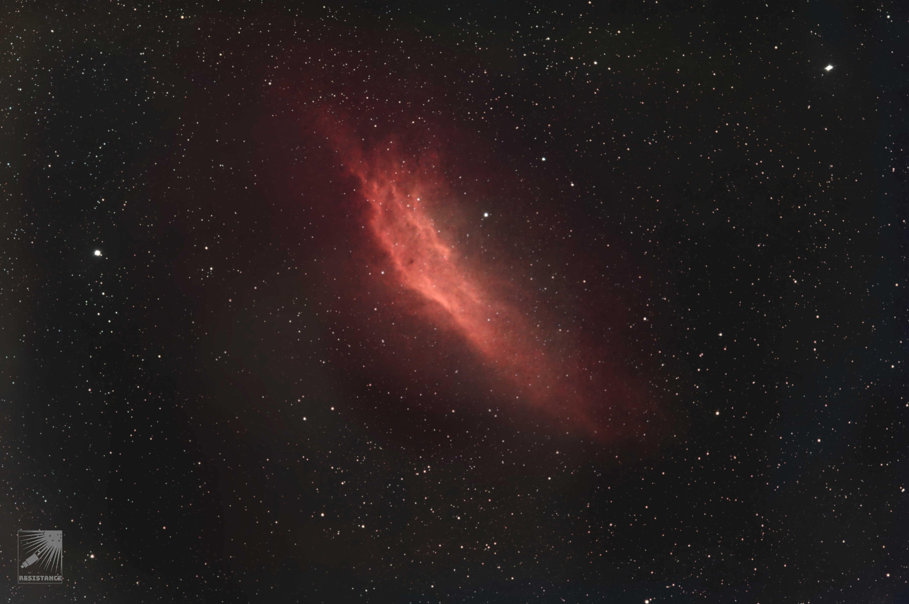
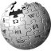
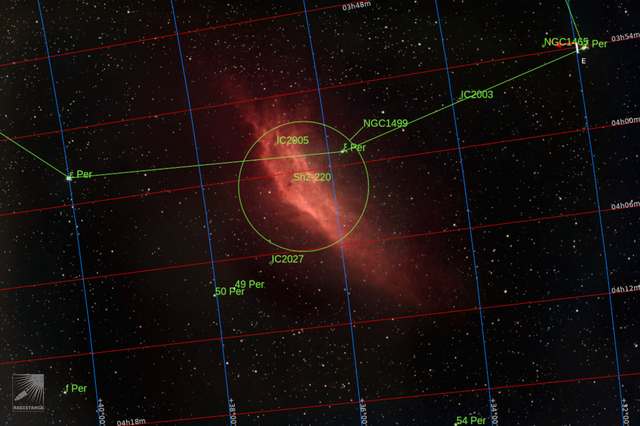
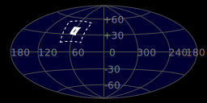
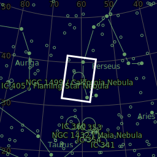
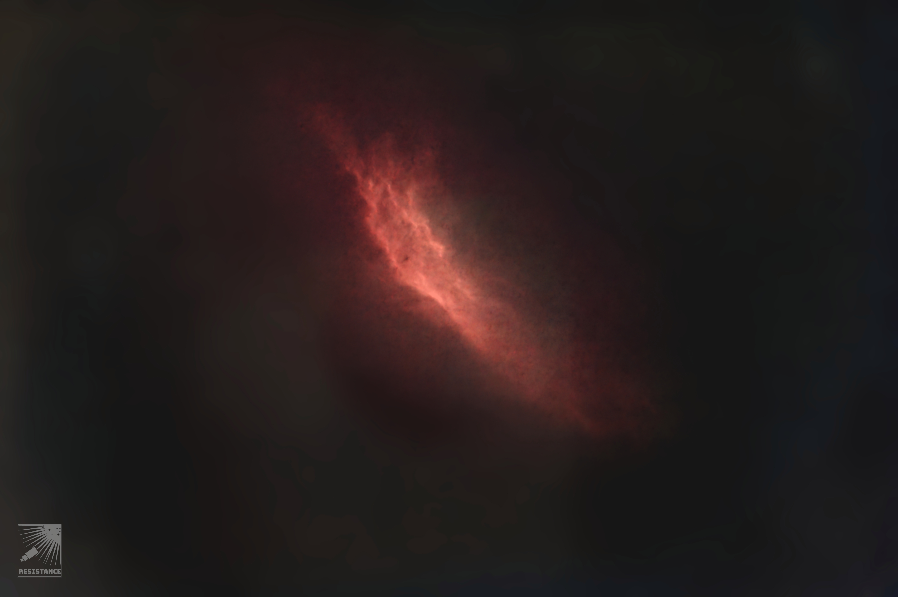
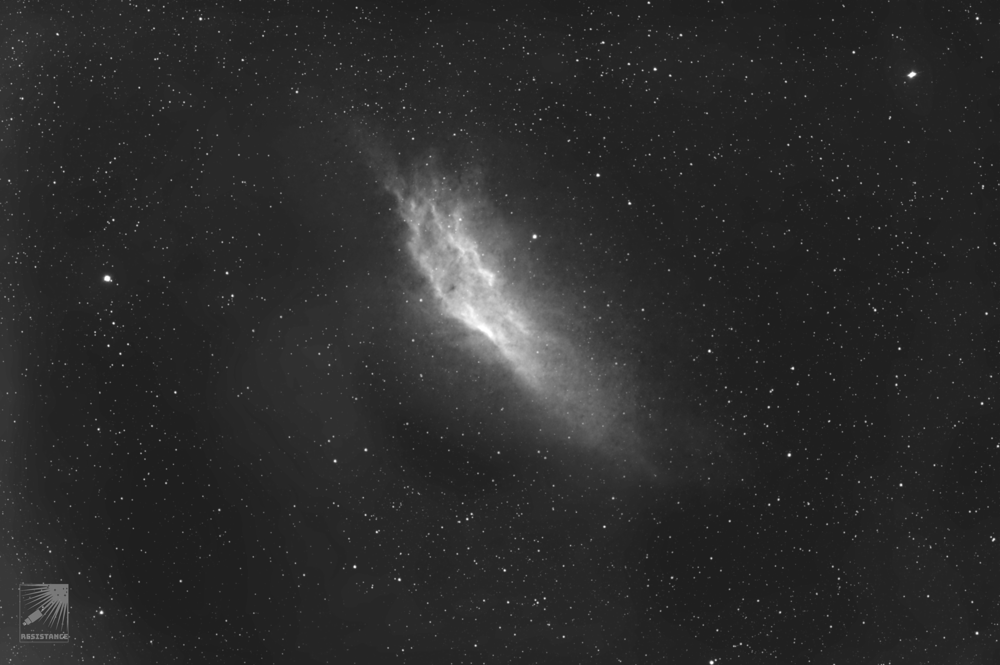

#  Full California Nebula

See [California Nebula](./California_Nebula.md)

[ Read more](https://en.wikipedia.org/wiki/California_Nebula)
## Plate solving 

| Globe | Close | Very close |
| ----- | ----- | ----- |
| | 

## Details

## Gallery
 

