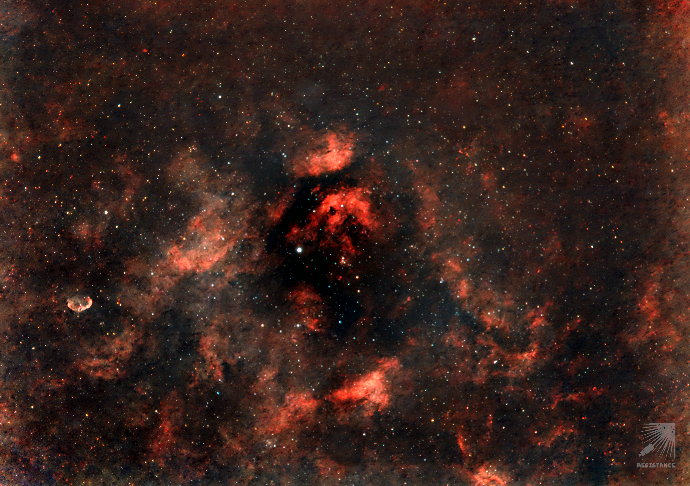

#  Gamma Cygni Nebula

IC 1318 (also known as Gamma Cygni Nebula) is the diffuse emission nebula and a H II region surrounding the star Sadr (γ Cygni) at the center of Cygnus's cross thus getting a nickname Sadr Region. The Sadr Region is one of the surrounding nebulous regions; others include the Butterfly Nebula and the Crescent Nebula. It contains many dark nebulae in addition to the emission diffuse nebulae.

[ Read more](https://en.wikipedia.org/wiki/IC_1318)
## Plate solving 

| Globe | Close | Very close |
| ----- | ----- | ----- |

## Details

## Gallery
 

