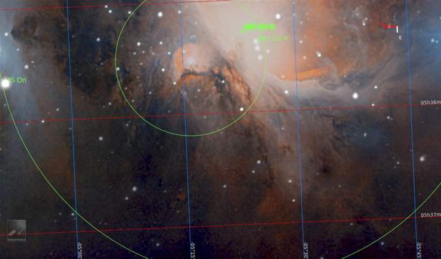
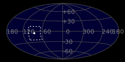
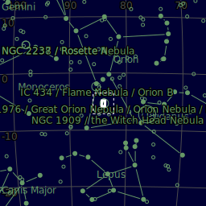
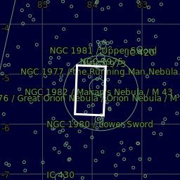
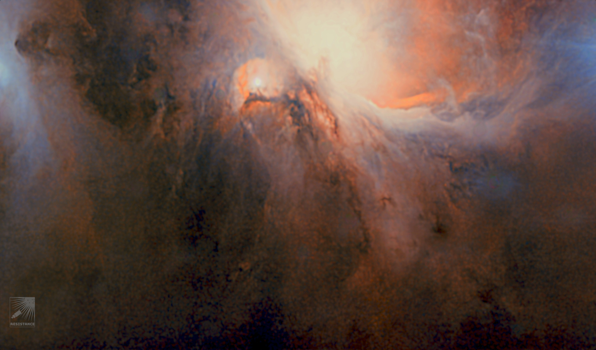
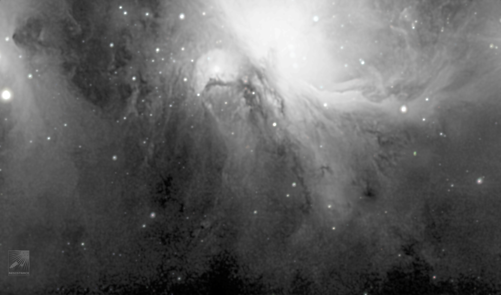

#  Mairan Nebula

Messier 43 or M43, also known as De Mairan's Nebula and NGC 1982, is a star-forming nebula with a prominent H II region in the equatorial constellation of Orion. It was discovered by the French scientist Jean-Jacques d'Ortous de Mairan some time before 1731,[3] then catalogued by Charles Messier in 1769.[a] It is physically part of the Orion Nebula (Messier 42), separate from that main nebula by a dense lane of dust known as the northeast dark lane.[5] It is part of the much larger Orion molecular cloud complex.v The main ionizing star in this nebula is the quadruple star system NU Orionis (HD 37061), the focus of the H II region, 1,360 ± 30 ly (417.0 ± 9.2 pc) away.[6] This star system is not hot enough to produce significant amounts of [O III] emission, unlike the Trapezium in the Orion Nebula.[7]

[ Read more](https://en.wikipedia.org/wiki/Messier_43)
## Plate solving 

| Globe | Close | Very close |
| ----- | ----- | ----- |
| | | |

## Details

## Gallery
 

