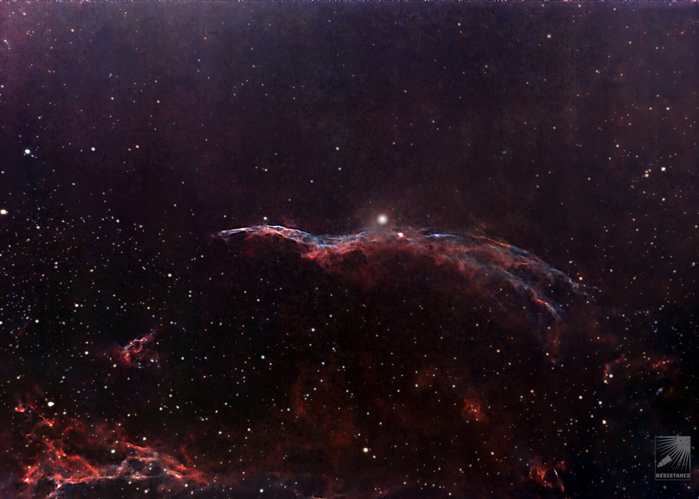
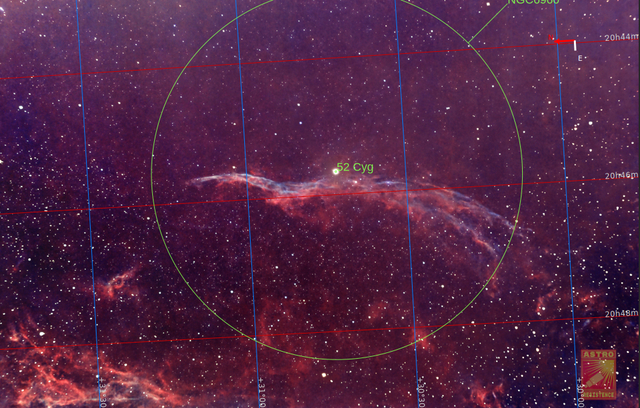
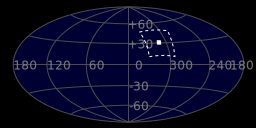
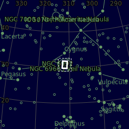
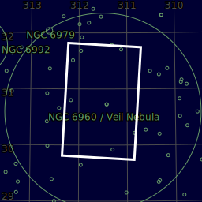
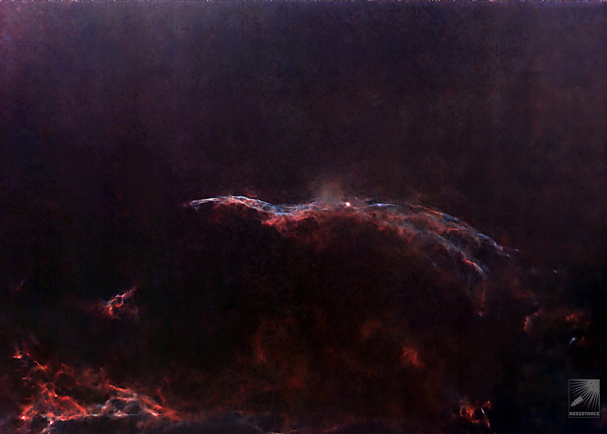
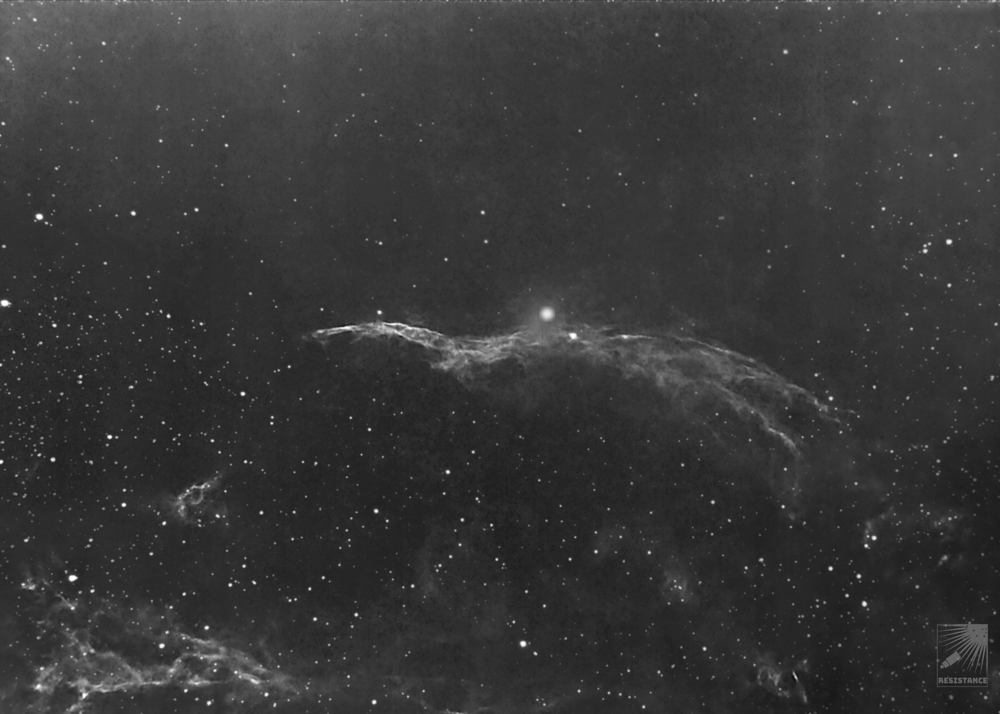

#  West Veil Nebula

In modern usage, the names Veil Nebula, Cirrus Nebula, and Filamentary Nebula generally refer to the brightest part of the visible structure of the remnant, or even to the entire loop itself. The structure is so large that several NGC numbers were assigned to various arcs of the nebula.[9] There are three main visual components: The Western Veil (also known as Caldwell 34), consisting of NGC 6960 (the "Witch's Broom", Lacework Nebula,"Filamentary Nebula") near the foreground star 52 Cygni; The Eastern Veil (also known as Caldwell 33), whose brightest area is NGC 6992, trailing off farther south into NGC 6995 (together with NGC 6992 also known as "Network Nebula") and IC 1340; Pickering's Triangle (or Pickering's Triangular Wisp), brightest at the north central edge of the loop, but visible in photographs continuing toward the central area of the loop.

[ Read more](https://en.wikipedia.org/wiki/Veil_Nebula)
## Plate solving 

| Globe | Close | Very close |
| ----- | ----- | ----- |
| | | |

## Details

## Gallery
 

